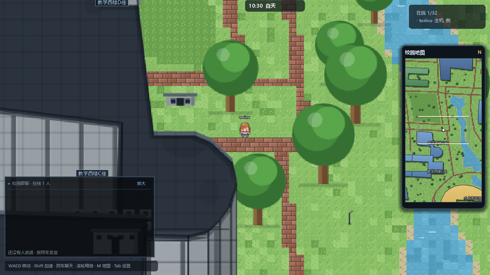
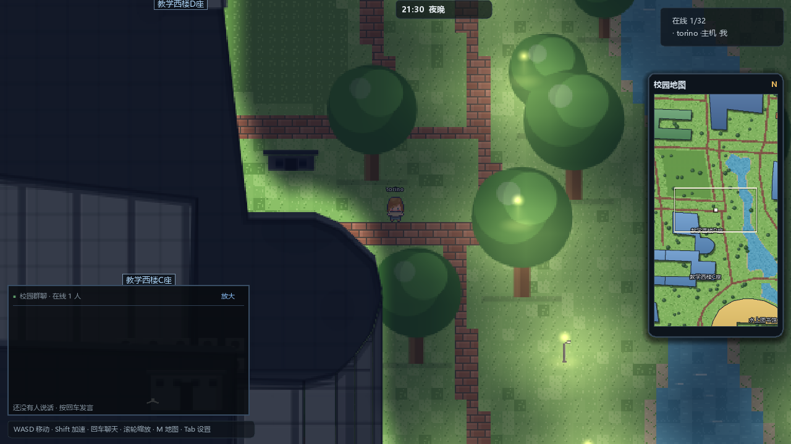
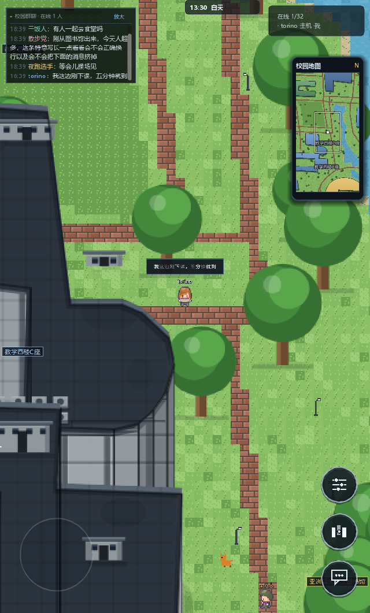

<div align="center">

# 像素工大 · 长安校区

**把西北工业大学长安校区做成一张可以走进去的像素地图。**

Godot 4 实现 · 桌面 / 手机 / 网页三端 · 支持多人在线同屏与群聊

<p>



</p>

</div>

---

## 这是什么

一张按真实校园地理数据铺出来的像素地图。建筑轮廓、道路、水系、绿地都来自
OpenStreetMap 上长安校区的实测数据，不是手绘示意图 —— 所以你熟悉的每一栋楼都在它该在的位置上，
包括教学楼、图书馆、食堂、宿舍和海天苑。

整个地图是程序化绘制的：没有一张贴图素材，草地、砖路、树、楼体、窗户全部由代码生成，
天气与昼夜也是实时算的。傍晚路灯亮起来，宿舍楼的窗户会一层层亮灯，天亮了再关掉。

## 现在能玩到什么

- **走遍校园** — 424 × 800 格的完整校区，58 栋建筑全部按真实轮廓做 2.5D 挤出，楼高按真实层数换算
- **真实的遮挡** — 人物走到楼后面会被楼挡住；挡住你的那栋楼会自动变半透明，不会跟丢自己
- **昼夜循环** — 游戏内 1 分钟 = 现实 1 秒，黄昏与夜间的窗光、路灯是单独一层光
- **多人在线** — 同一张地图上最多 32 人，能看到彼此走动、头顶名字和表情动作
- **群聊** — 左下角公共聊天框，按回车说话，所有人都能看见；聊天记录存在服务器上，后来的人能看到刚才在聊什么
- **全屏地图** — 按 `M` 打开，点哪里就传送到哪里；右上角常驻小地图显示身边情况
- **手机适配** — 竖屏布局、浮动摇杆、双指缩放、可放大的聊天框、局部视野小地图
- **能坐下** — 校园长椅和宿舍空间的椅子都能坐，按 `E` 坐下 / 起身
- **宿舍空间** — 走到宿舍楼旁按 `E` 进去，一排 8 个独立小隔间 + 休息区

## 下载 / 直接玩

在 [Releases](../../releases) 里下载：

| 平台 | 文件 | 说明 |
|---|---|---|
| Windows | `XGD-Campus-win64.zip` | 解压后双击 `像素工大.exe`，免安装 |
| Android | `XGD-Campus-android.zip` | 解压安装 `.apk`，需要允许「安装未知来源应用」 |

最新版本是 [v1.1.0](../../releases/tag/v1.1.0)（2026-10-30），桌面版压缩包里附了「玩法说明.txt」。

## 更新日志

### v1.1.0 · 2026-10-30

**宿舍空间改成一个个小隔间** — 原来是一间空旷的大房间，现在是一排 8 个独立的小隔间：
三面隔板、开口朝中间的休息区，每间一张桌、一台亮着的显示器、一把椅子。
休息区加了沙发、地毯、茶几和坐垫，东侧是贩卖机和储物柜，南墙一扇玻璃移门。
房间与家具全部按人物比例重算，不再是小人站在大房间里。

**坐着终于是坐着了** — 旧椅子是一块 26×26 的方块，比人还大，坐进去像被箱子吞掉；
椅背还和人身上的蓝衬衫同色，分不出哪是人哪是椅子。现在按人物定尺寸（坐垫 16×12、
椅背 13×12），改成黑椅 + 橙色腰线，椅背画在人前面挡住臀腿、只露头和肩。

**只有宿舍能进宿舍空间** — 判据从「名字带『座』」改成「星天苑 / 云天苑 / 海天苑」，
教学西楼、教学东楼那 8 栋教学楼不再误触发。

**其它** — 房间相机边界改成房间矩形（走到墙角不再露黑）；修掉地板烘焙里
`Image.fill_rect` 不混合半透明色导致的「地毯变黑洞」；小地图补上隔间与家具配色。

### v1.0.0 · 2026-10-29

首个公开版本：完整校区、2.5D 建筑与遮挡、昼夜循环、多人在线 + 群聊、手机竖屏适配、
Windows / Android 安装包。

手机端是竖屏布局，右下角三个按钮依次是 **设置 / 地图 / 聊天**，屏幕左半边任意位置按下就是摇杆。

## 操作

**桌面**

| 操作 | 说明 |
|---|---|
| `WASD` / 方向键 | 移动 |
| `Shift` | 加速跑 |
| `空格` | 表情动作 |
| `回车` | 打开聊天输入，发完回车发送 |
| `M` | 全屏校园地图（再按 `M` 或 `Esc` 关闭） |
| 滚轮 | 缩放视野 |
| `Tab` | 设置面板（昵称、外观、服务器地址） |
| `E` | 上下文交互：坐下 / 站起来 / 进「宿舍空间」/ 离开房间（见下） |

**手机**

单指在左半屏按下拖动 = 摇杆；双指捏合 = 缩放；点右下按钮开地图 / 聊天 / 设置。
屏幕上方的交互提示本身就是按钮 —— 手机没有 `E` 键，点那行字就等于按 `E`。

## 交互（`E` / 点提示）

只有一个键，按「离得最近、最明确」的顺序依次判断：

| 你在哪 | 提示 | 按下去 |
|---|---|---|
| 坐着 | 按 E 站起来 | 起身 |
| 椅子旁边 | 按 E 坐下 | 坐到这把椅子上 |
| 房间里别处 | 按 E 离开「宿舍空间」 | 回到校园 |
| 校园里宿舍楼旁 | 星天苑H座 · 按 E 进入「宿舍空间」 | 进房间 |

坐下后按方向键也会自动站起来 —— 不然按 WASD 毫无反应，会以为卡死了。

能坐的椅子有两类：房间里 33 把（朝向按「对着最近的一张桌子」自动算），
校园里 6 处长椅（图书馆 / 东门 / 北门各两把）。

## 建筑内景

走到**宿舍楼**（星天苑 A~H、云天苑 A~F、海天苑 1/2 号楼，共 16 栋）旁边，
屏幕上方会浮出「星天苑H座 · 按 E 进入」，按 `E` 就进「宿舍空间」。
教学楼（教学西楼 / 教学东楼）不算宿舍，站在楼下不会出现提示。

房间里是一排 **8 个独立小隔间**：每间一桌、一台亮着的显示器、一把椅子、
一个收纳箱或绿植，三面隔板围起来，开口朝中间的休息区。休息区有沙发、地毯、
茶几和坐垫，东侧放着贩卖机和储物柜，南墙是一扇玻璃移门。
房间右上角的小地图会自动换成房间平面图，出来再换回校园图。

整间房由脚本生成，没有任何外部素材：

```
tools/make_dorm_room.py --ascii    # 改布局 → 重新生成 assets/rooms/dorm_space.json
```

尺度是拿人物当标尺定的：人物约 18px 高、11px 宽（≈2.25 格 × 1.4 格），
隔间净宽 5 格（40px）≈ 3.6 个人宽，塞一张 4 格宽的桌子，两侧各留半格 ——
像网吧的独立包厢，而不是空房间。改这个数字前先看 `make_dorm_room.py` 顶部的注释。

房间挂在校园北界之外的远处（`ROOM_ORIGIN`），不切场景、不搬玩家容器，
相机 y 排序碰撞多人同步全都照旧，玩家只是被传送过去。
相机边界在进出时切成「房间矩形」，所以走到墙角也不会看到屋外的黑。

### 椅子与坐姿

椅子是**两个节点**拼的，不是一个：

- `chair_seat`（z = -1）：坐垫与椅脚，永远压在人身后
- `chair_back`（z = +2）：椅背，永远在人前面 —— 坐下时挡住臀腿、只露头和肩

因为 Godot 的 y-sort 是整块比较，一个节点做不到「一半在身后、一半在身前」。
椅背摆哪一侧由座位朝向算：朝上坐（背对镜头、面向桌子）时椅背在近侧，
朝下坐（面向镜头）时在远侧。

坐姿帧来自角色图集（SkyOffice 的 52 帧，48~51 是四个方向的坐姿），
`tools/add_sit_anims.py` 把它们切成了动画。落点用 `tools/_probe_sit.gd`
对照过 —— 改椅子画法或落点前先跑一遍，看 `_scratch/sit_lab.png` 挑最像坐着的那个。

### 关于 SkyOffice

第一版房间的布局坐标搬自 [SkyOffice](https://github.com/jofftiquez/skyoffice) 的 Tiled 地图
（MIT），但**没有复制它的任何图片** —— SkyOffice 用的是 LimeZu「Modern Interiors」
商业素材包，那部分不能随仓库分发。现在的房间已经改成按本项目尺度重新排的隔间，
那份导入脚本（`tools/import_skyoffice_room.py`）保留作参考。

## 联机怎么连

三种方式，按你的场景挑一种：

**1. 同一个 WiFi（最简单）**

一台机器在设置里点「开房间」，其他人在设置里点「局域网」——
程序会自动在局域网里找到这间房，不用填任何地址。

**2. 自己在 Linux 上架一台服务器（异地联机）**

服务器只需要能跑一个无头 Godot 进程和一层反向代理。仓库里的
[`build/deploy`](build/deploy) 是完整可用的部署套件：

```bash
# 在服务器上（Ubuntu / Debian，root 执行）
sudo bash install.sh                          # 纯 HTTP 版
sudo DOMAIN=game.example.com bash install.sh  # 有域名：自动签 HTTPS 证书
```

它会装好 Caddy、建 `/opt/xgd/{server,web}`、注册 systemd 服务并自检。
装完之后，客户端在设置里把「服务器地址」填成 `ws://你的IP/ws` 就能连。

**3. 网页版**

网页版是单机的（浏览器里没有 UDP，建不了 ENet 主机）。
如果服务器上同时部署了网页包，浏览器打开地址就能直接玩，
多人还需要走 `wss://`，细节见 [`build/deploy/README.md`](build/deploy/README.md)。

> 服务器地址的优先级：`assets/server.local.json`（本机私有，已被 git 忽略）
> → 环境变量 `XGD_SERVER` → `assets/server.json`（仓库里的空模板）。
> 所以别人 clone 下来不会连到我的服务器上，得自己填。

## 自己改 / 自己编译

**需要**：Godot **4.7.2**（Standard 版即可）、对应的导出模板。

用 Godot 打开 `project.godot`，`F5` 直接跑。

```
sxgd-game/
├── assets/world.json          ★ 世界数据：建筑轮廓、道路、水面、装饰、出生点、POI
├── scenes/                    主场景
├── net/                       联机与 UI（Net / Arena / 聊天 / 小地图 / 摇杆 / 世界地图）
├── scripts/                   渲染与着色器（楼体 2.5D、窗光、光照图、昼夜）
├── addons/godot_ai/           开发期用的编辑器 AI 插件，不影响游戏，可以整个删掉
├── tools/                     构建与烘焙脚本（世界场景、房间布局、字体子集、图标、小地图底图）
└── export_presets.example.cfg  三套导出预设（复制成 export_presets.cfg 再填签名，别提交密钥）
```

**改地图** — 编辑 `assets/world.json` 后重新烘焙场景：

```bash
godot --headless --path . --script tools/build_world_scene.gd --force
```

**改字体** — 中文用的是按需裁剪的思源黑体子集（166 KB，只含游戏里出现的字）：

```bash
python tools/make_font.py
```

**导出** — 先把 `export_presets.example.cfg` 复制成 `export_presets.cfg`，填上自己生成的
Android 签名密钥库路径与密码（这个文件被 git 忽略，不要把密钥提交上来），
之后 Godot 里 `项目 → 导出` 就有三套预设了。

## 实现上几个关键选择

- **数据只认 OSM** — `world.json` 由 OSM 导出生成，建筑名字与轮廓以测绘数据为准；
  OSM 里没有的东西就不虚构。multipolygon relation（图书馆、海天苑宿舍等）单独解析，
  只处理 way 会整栋丢失。
- **遮挡用 depth 排序** — 所有东西按「脚底 y」排序，简单但和真实遮挡一致；
  挡住玩家的楼在这一帧降半透明，不做剪影。
- **窗光必须画在楼体自己的着色器里** — 挂在独立图层上会出现「被楼挡住的窗户照样透出来」。
  代价是楼体要自己承担夜幕压暗，全屏夜幕层在楼体像素上关掉。
- **人物比例是压缩的** — 楼高按真实米数 × 0.85 格换算。1:1 的话一栋宿舍楼会遮满屏幕。

## 数据与声明

- 地图数据 © [OpenStreetMap](https://www.openstreetmap.org/copyright) 贡献者，ODbL 协议
- 字体：思源黑体（Noto Sans SC）子集，SIL Open Font License
- 代码：MIT
- **本项目是校园爱好者的非官方作品**，与西北工业大学官方无关；校名、校徽等标识归学校所有，
  仅用于校园文化展示，不作商业用途

